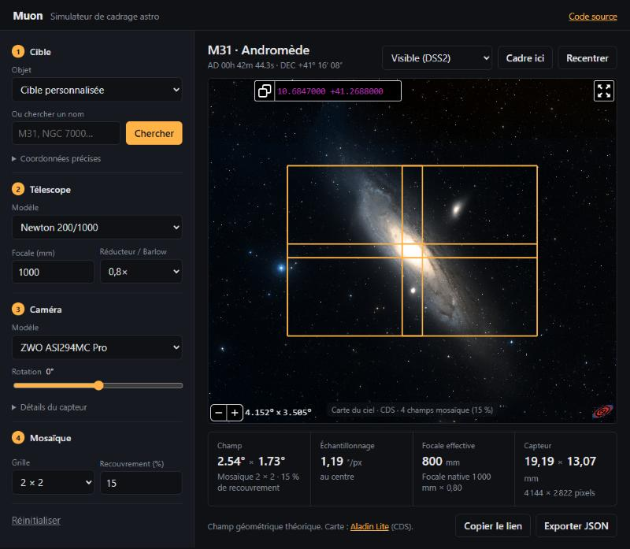

# Muon — Simulateur de cadrage astronomique

*[English](README.md) · Français*

**[▶ Ouvrir l'appli](https://nktrois.github.io/muon/)**, rien à installer.

**Muon** (du nom de la particule qui nous tombe du ciel avec les rayons cosmiques) affiche le **champ réellement couvert par ton capteur** sur une carte du ciel interactive. Sans installation, sans serveur, sans compte : il marche dans n'importe quel navigateur récent, sous Windows, macOS et Linux.



*Fond de ciel : relevé DSS2 couleur (STScI / CDS), affiché avec Aladin Lite.*

## Fonctionnalités

- Carte du ciel via **Aladin Lite**, avec images DSS2 (visible) ou 2MASS (infrarouge).
- Cibles prédéfinies : M31, M42, M45, M51, M63, M81/M82, NGC 4631, M27, M57, M13 et autres ; recherche de noms via Sesame (service CDS) ; coordonnées AD/DEC manuelles.
- Modèles de télescopes et **focale personnalisée**, réducteur ou Barlow (facteur libre).
- Modèles ZWO : ASI294MC Pro, ASI533MC Pro, ASI2600MC Pro, ASI585MC Pro, ASI183MC Pro ; capteur configurable (largeur/hauteur en pixels, taille des pixels).
- Rotation du cadre, panorama mosaïque 2×2, 3×3, 4×4 et recouvrement paramétrable.
- Calcul de l'**échantillonnage en arcsec/pixel**, dimensions du capteur, champ angulaire exact via `2 atan(dimension capteur / (2 focale))`.
- **Recentrage sur le ciel**, zoom automatique, lien partageable (les paramètres sont encodés dans l'URL), export JSON des paramètres, centre et emprise de chaque panneau.
- **HTML/CSS/JavaScript** simples, rien à installer ni à compiler.

## Lancer

**En ligne :** [https://nktrois.github.io/muon/](https://nktrois.github.io/muon/), sur ordinateur comme sur téléphone.

**Copie hors ligne :** télécharger le dépôt (*Code → Download ZIP*), le dézipper et double-cliquer sur `index.html`. Les calculs marchent sans Internet ; la carte du ciel et la recherche d'objets ont besoin d'une connexion.

## Tester le moteur de calcul

Node.js 18+ :

```bash
node --test tests/optics.test.js
```

Aucune dépendance npm nécessaire pour les tests.

## Limites importantes

- C'est un **simulateur de géométrie optique**, pas un calculateur de résolution réelle, de champ corrigé, de diffraction, de vignettage ni de rapport signal/bruit.
- Les calculs supposent un système rectilinéaire idéal ; les déformations optiques, la distorsion, le tilt et le champ utile du correcteur ne sont pas modélisés.
- Les coordonnées prédéfinies sont des centres approximatifs en ICRS/J2000 pour démarrer ; vérifier le cadrage sur le relevé. La recherche d'objets utilise le résolveur distant CDS/Sesame.
- Les mosaïques et la rotation utilisent une **projection gnomonique** (TAN) autour du centre ; les bords sont échantillonnés pour les grands champs.
- L'échelle en ″/pixel est celle au centre pour un pixel individuel. Le binning logiciel, les recadrages ROI, la rotation réelle de la caméra sur la monture et les limites mécaniques doivent être vérifiés séparément.
- L'application est statique mais le **fond de ciel et la recherche d'objets exigent Internet**. Si Aladin ne charge pas, les calculs restent disponibles.

## Références

- [Aladin Lite — CDS Strasbourg](https://aladin.cds.unistra.fr/AladinLite/) et [documentation API](https://aladin.cds.unistra.fr/AladinLite/doc/API/).
- [ZWO ASI294MC Pro — fiche constructeur](https://www.zwoastro.com/product/asi294/).
- [ZWO ASI2600MC Pro — fiche constructeur](https://www.zwoastro.com/product/new-asi2600mm-mc-pro/).
- [ZWO ASI533MC Pro — manuel](https://i.zwoastro.com/wp-content/uploads/2024/07/9f26af0bec5c60ea84107dfec8314859.pdf).
- [ZWO ASI585MC Pro — manuel](https://i.zwoastro.com/wp-content/uploads/2025/09/04a912015d682f11887ca758deedb947.pdf).

Hormis la capture d'écran de ce README, Muon ne contient aucune image de relevé astronomique : elles sont chargées chez leurs fournisseurs. L'interface Aladin conserve son attribution et ses liens.

## Licence

Code Muon : **MIT**, voir `LICENSE`.

[Aladin Lite](https://aladin.cds.unistra.fr/AladinLite/) (CDS Strasbourg, GPL-3) est chargé à l'ouverture depuis jsDelivr, en version figée 3.8.2 ; il n'est pas inclus dans ce dépôt. Les images du ciel viennent des serveurs HiPS du CDS ou de leurs miroirs (ESA, IRSA) et restent soumises aux conditions de leurs fournisseurs.
