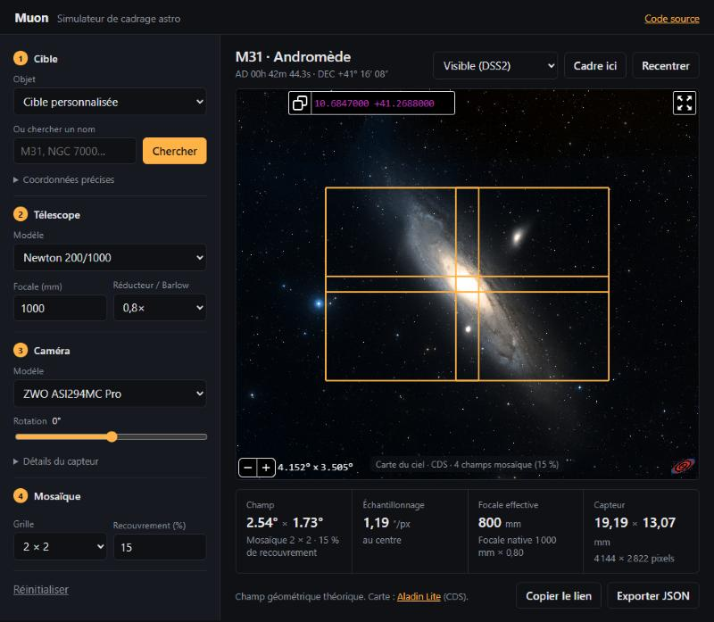

# Muon Deep Sky (Ciel profond) — astrophotography framing simulator

*English · [Français](README.fr.md)*

**[▶ Open the app](https://nktrois.github.io/muon-ciel-profond/)**, nothing to install.

**Muon Ciel profond** (deep-sky counterpart to Muon, named after the particle that rains down from cosmic rays) shows the **field actually covered by your camera sensor** on an interactive sky atlas. No install, no server, no account: it runs in any recent browser on Windows, macOS and Linux. The interface is in French.



*Sky background: DSS2 color survey (STScI / CDS), displayed with Aladin Lite.*

## Features

- Sky atlas with **Aladin Lite v3**, DSS2 (visible) or 2MASS (infrared) surveys.
- Preset targets (M31, M42, M45, M51, M81/M82, NGC 7000, M13…), name lookup through the CDS Sesame resolver, or manual RA/Dec.
- Telescope presets or **custom focal length**, reducer or Barlow with any factor.
- ZWO camera presets (ASI294MC, ASI533MC, ASI2600MC, ASI585MC, ASI183MC) or a custom sensor (pixel count and pixel size).
- Frame rotation, 2×2 to 4×4 mosaics with adjustable overlap.
- **Image scale in arcsec/pixel**, sensor size, exact field of view `2 atan(sensor size / (2 focal))`.
- Shareable link (settings encoded in the URL) and JSON export of each panel's center and footprint.
- Plain **HTML/CSS/JavaScript**, no build step, nothing to install.

## Run it

**Online:** [https://nktrois.github.io/muon-ciel-profond/](https://nktrois.github.io/muon-ciel-profond/), works on computer and phone.

**Offline copy:** download the repository (*Code → Download ZIP*), unzip it and double-click `index.html`. The calculations work without Internet; the sky map and object search need a connection.

## Tests

Node.js 18+, no npm dependencies:

```bash
node --test tests/optics.test.js
```

`tests/ui-smoke.py` is an optional browser test (Python Playwright + Chromium).

## Limitations

- This is an **optical geometry simulator**: no diffraction, vignetting, distortion, tilt, corrected field or signal-to-noise.
- Ideal rectilinear system; mosaics and rotation use a gnomonic (TAN) projection around the center.
- Preset coordinates are approximate ICRS/J2000 centers; check the framing on the survey.
- The image scale is the one at the center for a single pixel. Binning, ROI, real camera rotation and mechanical limits must be checked separately.
- The app is static, but the **sky background and object search need Internet**. Calculations still work if Aladin doesn't load.

## Credits and license

Muon code: **MIT**, see `LICENSE`.

[Aladin Lite](https://aladin.cds.unistra.fr/AladinLite/) (CDS Strasbourg, GPL-3) is loaded at runtime from jsDelivr, version pinned to 3.8.2; it is not included in this repository. Sky images come from the CDS HiPS servers or their mirrors (ESA, IRSA) and remain subject to their providers' terms.
